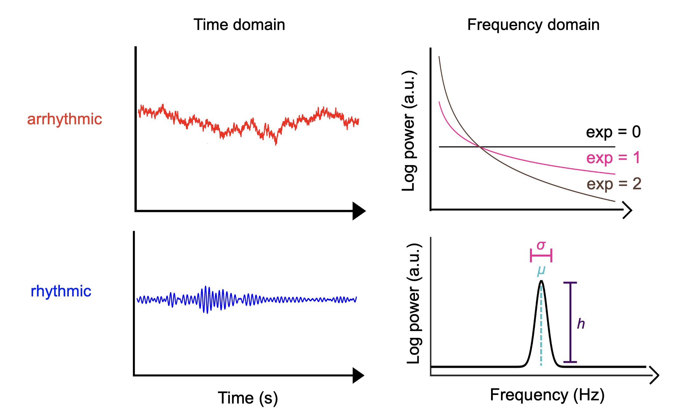
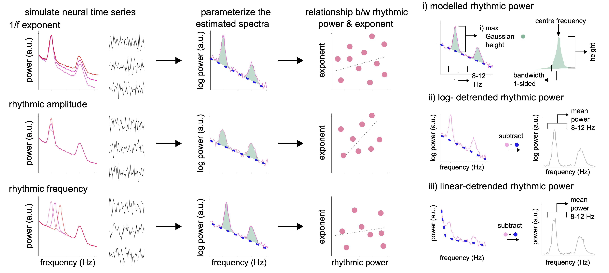
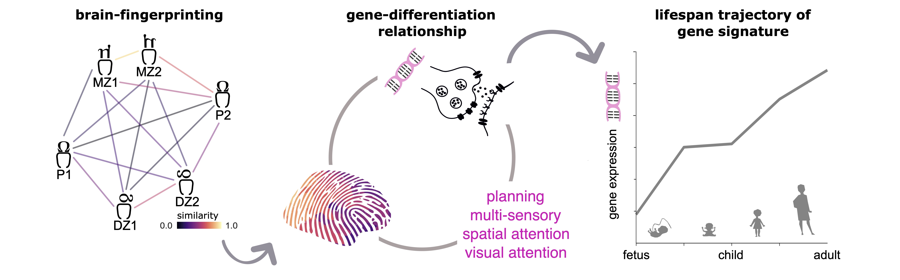
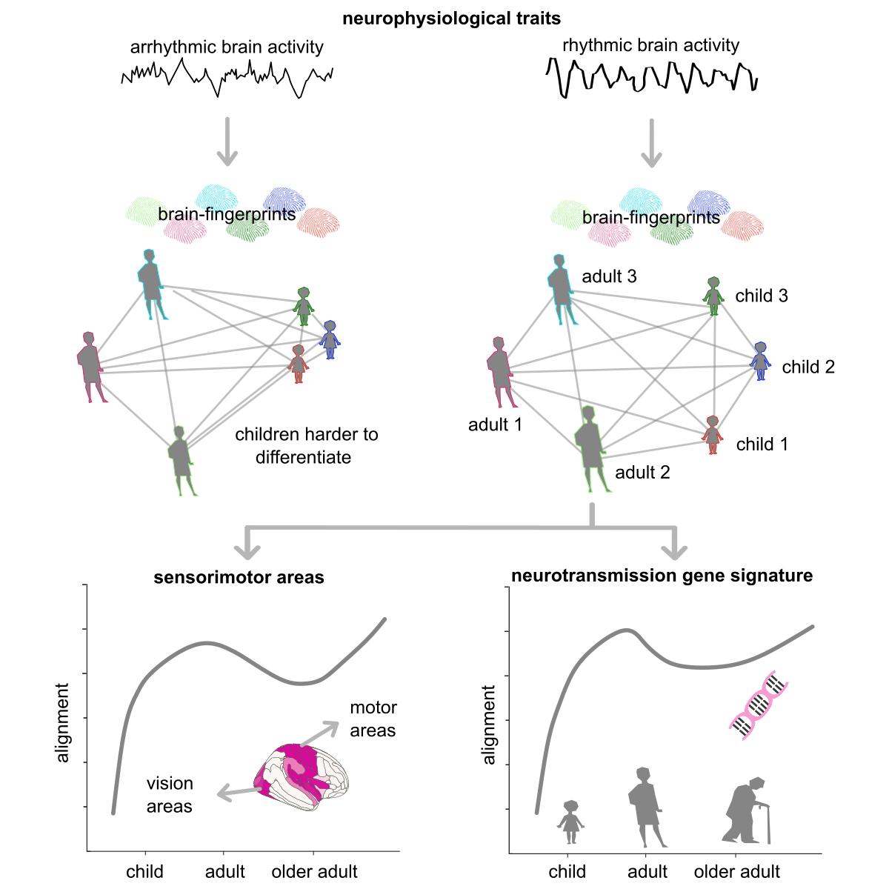

:::: {.columns}
::: {.column-screen-inset-left width="5%"}

---
title: "Jason da Silva Castanheira"
subtitle: "Postdoctoral Research Fellow"
about: 
  template: trestles
  image: profile.jpg
  image-shape: rectangle
  links:
    - icon: envelope
      text: Email
      href: "mailto:j.castanheira@ucl.ac.uk"
    - icon: mortarboard-fill
      text: Scholar
      href: "https://scholar.google.ca/citations?user=sXxW8FIAAAAJ&hl=en&authuser=1"
    - icon: bluesky
      text: Bluesky
      href: "https://bsky.app/profile/jasondasilvac.bsky.social"
    - icon: linkedin
      text: Linkedin
      href: "https://www.linkedin.com/in/jason-da-silva-castanheira-834a132b8/"
    - icon: ORCID
      text: ORCID
      href: "https://orcid.org/0000-0002-7022-9009"
    - icon: github
      text: GitHub
      href: "https://github.com/dasilvacastanheira"
---

---
title: "Jason da Silva Castanheira"
execute:
  freeze: false
---

:::

```{r}
#| include: false
source("bibtools.R")
```


::: {.column-screen-inset-left width="95%"}

My research is broadly interested in tackling how brain rhythms can explain our unique behavioural patterns and subjective experiences

#### Attention & Consciousness
Our senses are constantly bombarded with information. We must select a subset of this information to preferentially process. I am interested in these attention orienting processes. Specifically, my research examines i) ***how different types of attention systems interact with one another*** and ii) ***how we construe our environment in service of our goals***.

Recently, I have examined attention biases in how people construe problems for planning. using computational modelling, I've explored visuospatial attentional biases in how we construe problems both tied to percpetion and from our imaginations. 

In the future, I wish to explore:

* How people construe problems from their imagination.

* How people simultaneously orient their attention internally and externally to guide adptive behaviours.

* How construal processes go awry in mental health.

#### Brain Rhythms
Since the invention of EEG, over a century ago, people have been interested in measuring brain rhythms. This isn't always easy! Brain activity is characterized by several brain rhythms and by background *noise*. This background *noise*, however, relates to people's age and predicts cognitive performance. Yet, the question remains ***how do we measure rhythmic and arrhythmic brain activity*** and ***how do these components contribute to our subjective experiences***.



We have made available tools to paramertize the neural power spectrum using [Bayesian model selection](https://pmc.ncbi.nlm.nih.gov/articles/PMC11326208/) and [time resolved estimates of arrhythmic and rhythmic brain activity](https://elifesciences.org/articles/77348).

I've also explored, using simulations, best practices for detrending neural power spectra. Here, we find that **modeled rhythmic power** is the best way to decompose arrhythmic and rhythmic components without introducing spurious relationships between the components.



#### Inter-individual differences 
We all have the intuition that we are unique individuals; but ***how unique is your brain (activity)?*** Researchers, including myself, have pioneered techniques to study this question. 

[Finn and colleagues in 2015](https://www.nature.com/articles/nn.4135) first put forward the idea of a brain-fingerprint: *brain activity that  differentiates you from a cohort of people*. Much like a fingerprint left by your hand we can distinguish people from one another using these *brain-fingerprints*. But unlike the fingerprints left by your hand, brain-fingerprints relate to inter-individual differences in cognitive performance and are shaped by demographic variables.

My work on brain-fingerprinting established that individuals can be differentiated from one another using [brief 30-second recordings of brain activity](https://www.nature.com/articles/s41467-021-25895-8). People's unique brain rhythms are remarkably stable across months!

I've also shown that monozygotic (identical) twins have very similar brain-fingerprints. This suggests that [brain-fingerprints are heritable](https://www.science.org/doi/full/10.1126/sciadv.ads7544)! Unique patterns of brain rhythms also relate to patterns of cortical gene expression.



The features that set us apart from one another also [differ across the lifespan](https://www.cell.com/cell-reports/fulltext/S2211-1247(25)01429-9), with rhythmic brain activity being particulalry good at distinguishing individuals across the entire lifespan. 



Moving forward, I wish to explore:

* What life-chaining moments permanently change our unique brain rhythms?

* How do brain rhythms relate to how we percieve and experience the world?

:::
::::

