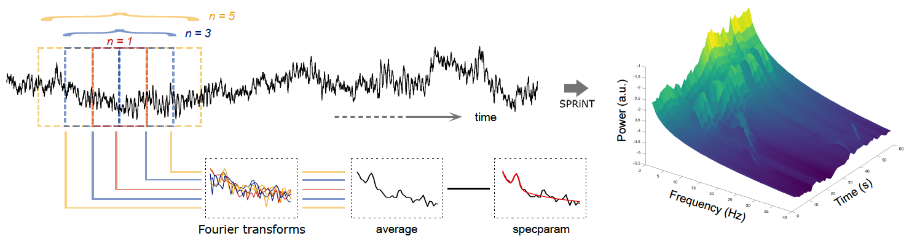

:::: {.columns}
::: {.column-screen-inset-left width="5%"}

---
title: "Jason da Silva Castanheira"
subtitle: "Postdoctoral Research Fellow"
about: 
  template: trestles
  image: profile.jpg
  image-shape: rectangle
  links:
    - icon: envelope
      text: Email
      href: "mailto:j.castanheira@ucl.ac.uk"
    - icon: mortarboard-fill
      text: Scholar
      href: "https://scholar.google.ca/citations?user=sXxW8FIAAAAJ&hl=en&authuser=1"
    - icon: bluesky
      text: Bluesky
      href: "https://bsky.app/profile/jasondasilvac.bsky.social"
    - icon: linkedin
      text: Linkedin
      href: "https://www.linkedin.com/in/jason-da-silva-castanheira-834a132b8/"
    - icon: ORCID
      text: ORCID
      href: "https://orcid.org/0000-0002-7022-9009"
    - icon: github
      text: GitHub
      href: "https://github.com/jasondsc"
---

---
title: "Jason da Silva Castanheira"
execute:
  freeze: false
---

:::

```{r}
#| include: false
source("bibtools.R")
```

::: {.column-screen-inset-left width="95%"}
Below please find a summary of helpful (teaching) resources.

#### How to measure brain rhythms
Brain activity is composed of both ***rhythmic*** and ***arrhythmic*** components. Researchers theorize that both components are generated by different neural mechanisms and are believed to behaviour independently. I am interested in i) how to best ***quantify rhythmic and arrhythmic brain activity*** and ii) how does arrhythmic and ***rhythmic brain activity relate to our subjective experiences***. 



For a detail tutorial on how to parameterize the neural power spectrum please visit the Brainstorm tutorial pages for [ms-specparam](https://neuroimage.usc.edu/brainstorm/Tutorials/Fooof?highlight=%28specparam%29). Please visit the [Spectral Parameterization Resolved in Time (SPRiNT)](https://neuroimage.usc.edu/brainstorm/Tutorials/SPRiNT?highlight=%28specparam%29) if you would like to learn more about time resolved measures of arrhythmic and rhythmic brain activity.

#### How to brain-fingerprint?
Researcher, including myself, have pioneered techniques to study how brain activity is unique to an individual. Brain-fingerprints are features of people's *brain activity that set them apart from the crowd*--much like your fingerprint.

[Finn and colleagues in 2015](https://www.nature.com/articles/nn.4135) first put forward the idea of a 
Brain-fingerprinting is one method to assess inter-individual differences in brain activity, pioneered by [Finn and colleagues in 2015](https://www.nature.com/articles/nn.4135). If you would like to know more about brain-fingerprinting and how it is done please see the [Brainstorm tutorial page](https://neuroimage.usc.edu/brainstorm/Tutorials/BrainFingerprint?highlight=%28brain%29%7C%28fingerprint%29).


#### Coding resources 
* If you would like to learn how to code in [R and some basic statistics](https://github.com/gsan-codes/Sta-R-tistics), please check out my 8-week workshop class.

* If you would like to learn to code [MATLAB and some basic signal processing tools](https://github.com/dasilvacastanheira/MATDRAB2MATFAB), please check out my 8-week workshop class. 

:::
::::

