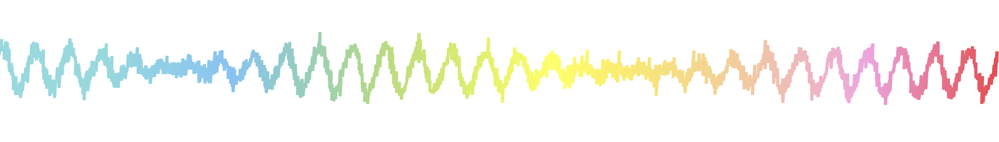

:::: {.columns}
::: {.column-screen-inset-left width="5%"}

---
title: "Jason da Silva Castanheira"
subtitle: "Postdoctoral Research Fellow"
about: 
  template: trestles
  image: profile.jpg
  image-shape: rectangle
  links:
    - icon: envelope
      text: Email
      href: "mailto:j.castanheira@ucl.ac.uk"
    - icon: mortarboard-fill
      text: Scholar
      href: "https://scholar.google.ca/citations?user=sXxW8FIAAAAJ&hl=en&authuser=1"
    - icon: bluesky
      text: Bluesky
      href: "https://bsky.app/profile/jasondasilvac.bsky.social"
    - icon: linkedin
      text: Linkedin
      href: "https://www.linkedin.com/in/jason-da-silva-castanheira-834a132b8/"
    - icon: ORCID
      text: ORCID
      href: "https://orcid.org/0000-0002-7022-9009"
    - icon: github
      text: GitHub
      href: "https://github.com/dasilvacastanheira"
---

:::

::: {.column-screen-inset-left width="95%"}

# About me

I am a postdoctoral research fellow at UCL studying consciousness, attention, and inter-individual differences with [Prof. Stephen Fleming](https://metacoglab.org). My work blends cognitive science, computational modelling, and neurophysiology to understand how brain rhythms support our unique subjective experiences. 

I completed my PhD with [Prof. Sylvain Baillet](https://www.neurospeed-bailletlab.org/sylvain-baillet) at McGill University in the Montreal Neurological Institute (MNI). There I studied how individuals brain activity is characteristic to them, much like a fingerprint left by your hand. My thesis, [*MEG, myself, and I: Understanding inter-individual diversity of neurophysiological brain activity*](https://mcgill.scholaris.ca/items/481cd4b9-a799-4555-b22c-dbaae8138fd5) was awarded the Governor General's Gold Medal for outstanding doctoral
thesis in the Natural Sciences.

* [What I'm interested in](Research.qmd)

* [What I've been up to](cv.qmd)

* [What I've been working on](publications.qmd)

* [What I find helpful](Teaching.qmd)

* [Who I've been working with](friends.qmd)

:::
::::
